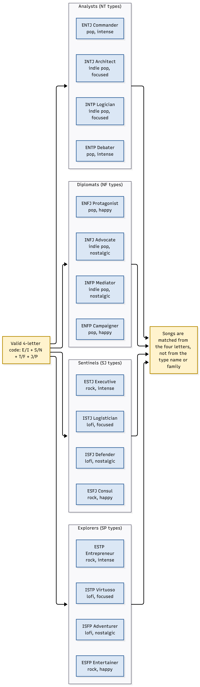

# 🎵 Music Recommender Simulation

## Project Summary

This project builds a simple music recommender that ranks songs based on a user's taste profile. It uses song features like genre, mood, energy, tempo, valence, danceability, and acousticness to score each track and recommend the best matches.

The system is intentionally small and easy to explain. It shows how a content-based recommender works, how changing the weights changes the results, and where the logic can become biased or overly narrow. We also tested different user profiles, compared how the outputs changed, and reflected on why some songs keep appearing because of exact genre or mood matches.

This version is meant to explore both the strengths and the limits of simple recommendation systems in a way that is easy to understand and test.

---

## How The System Works

This recommender is a simple content-based music system. Instead of looking at what other users listen to, it compares each song to the user’s taste profile using the song’s own features.

Each Song includes:
- genre
- mood
- energy
- tempo
- valence
- danceability
- acousticness

Each UserProfile stores the user’s overall preferences:
- favorite_genre
- favorite_mood
- target_energy
- target_valence
- likes_acoustic
- preferred_tempo_range
- reality_anchor

The recommender scores each song by how well it matches that profile. A matching genre gets the biggest bonus, a matching mood gets a strong bonus, and then the system checks how close the song’s energy, valence, acousticness, and danceability are to the user’s preferred values. The idea is to reward songs that are close to the user’s taste, not just songs that are “higher” or “lower” in one number.

For example, if the user likes slow, romantic, reflective songs, then a mellow indie pop track with warm valence and moderate energy should score higher than an intense rock song with a completely different mood. After scoring every song, the system ranks them and returns the top K songs.

This is a content-based approach because it uses the actual characteristics of the songs, not other people’s listening behavior. It is simple, explainable, and easy to tune.

**Biases and limits**
This system is useful, but it can still be biased. It may over-prioritize popular or viral songs, ignore older songs that fit the user’s mood, or become too narrow if the profile is built around one genre or one emotional state. It can also over-focus on comfort and miss songs that are good for reflection or returning to reality. In short, it works well for matching taste, but it is still a simplified version of how real recommenders behave.

---
## System Architecture

This diagram shows the whole system. Green boxes are built (the Module 3 recommender and its 65-song catalog). Yellow boxes are the planned final-project extension: the MBTI profile builder, confidence score, bias check, and Gemini assistant with verification.


Source: [diagrams/architecture.mmd](diagrams/architecture.mmd)

### MBTI types and how they map to songs

All 16 types, grouped into four families. The family and type name are display labels only. Songs are matched from the four letters.



Source: [diagrams/mbti_types.mmd](diagrams/mbti_types.mmd)

---

## Getting Started

### Setup

1. Create a virtual environment (optional but recommended):

   ```bash
   python -m venv .venv
   source .venv/bin/activate      # Mac or Linux
   .venv\Scripts\activate         # Windows

2. Install dependencies

```bash
pip install -r requirements.txt
```

3. Run the app:

```bash
python -m src.main
```

### Running Tests

Run the starter tests with:

```bash
pytest
```

You can add more tests in `tests/test_recommender.py`.

---

## Sample Recommendation Output

Loaded songs: 20

Top recommendations:

1. Rooftop Lights by Indigo Parade
   Score: 2.00
   Why:
      - genre match (+2.0)

2. Stupid Song by Olivia Rodrigo
   Score: 2.00
   Why:
      - genre match (+2.0)

3. Heaven by Bryan Adams
   Score: 1.00
   Why:
      - mood match (+1.0)

4. Sunrise City by Neon Echo
   Score: 0.00
   Why:
      - 

5. Midnight Coding by LoRoom
   Score: 0.00
   Why:
      - 
```

**Screenshot or video** *(optional)*: <!-- Insert a screenshot or demo video link here -->

---

## Experiments You Tried

## Experiments You Tried

I tested four user profiles and looked at the top 5 results for each.

### High-Energy Pop

```
=== High-Energy Pop ===
1. Sunrise City by Neon Echo
   Score: 6.83
   Why:
      - genre match (+2.0)
      - mood match (+1.0)
      - energy close to target (+1.38)
      - valence close to target (+0.96)
      - acousticness close to target (+0.74)
      - danceability close to target (+0.47)
      - tempo close to target (+0.28)

2. Gym Hero by Max Pulse
   Score: 5.95
   Why:
      - genre match (+2.0)
      - energy close to target (+1.46)
      - valence close to target (+0.97)
      - acousticness close to target (+0.76)
      - danceability close to target (+0.48)
      - tempo close to target (+0.28)

3. Rooftop Lights by Indigo Parade
   Score: 4.66
   Why:
      - mood match (+1.0)
      - energy close to target (+1.29)
      - valence close to target (+0.99)
      - acousticness close to target (+0.60)
      - danceability close to target (+0.48)
      - tempo close to target (+0.30)

4. Magoots for Brain by Olivia Rodrigo
   Score: 3.84
   Why:
      - energy close to target (+1.48)
      - valence close to target (+0.87)
      - acousticness close to target (+0.78)
      - danceability close to target (+0.48)
      - tempo close to target (+0.22)

5. Storm Runner by Voltline
   Score: 3.59
   Why:
      - energy close to target (+1.48)
      - valence close to target (+0.68)
      - acousticness close to target (+0.80)
      - danceability close to target (+0.41)
      - tempo close to target (+0.22)
```

Observation: Sunrise City and Gym Hero lead, which matches what I expected. Positions 4 and 5 have no genre or mood match and rank only because their energy is close to 0.9.

### Chill Lofi

```
=== Chill Lofi ===
1. Library Rain by Paper Lanterns
   Score: 7.03
   Why:
      - genre match (+2.0)
      - mood match (+1.0)
      - energy close to target (+1.50)
      - valence close to target (+1.00)
      - acousticness close to target (+0.75)
      - danceability close to target (+0.49)
      - tempo close to target (+0.29)

2. Midnight Coding by LoRoom
   Score: 6.86
   Why:
      - genre match (+2.0)
      - mood match (+1.0)
      - energy close to target (+1.40)
      - valence close to target (+0.96)
      - acousticness close to target (+0.73)
      - danceability close to target (+0.49)
      - tempo close to target (+0.29)

3. Focus Flow by LoRoom
   Score: 5.98
   Why:
      - genre match (+2.0)
      - energy close to target (+1.42)
      - valence close to target (+0.99)
      - acousticness close to target (+0.78)
      - danceability close to target (+0.50)
      - tempo close to target (+0.29)

4. Spacewalk Thoughts by Orbit Bloom
   Score: 4.71
   Why:
      - mood match (+1.0)
      - energy close to target (+1.40)
      - valence close to target (+0.95)
      - acousticness close to target (+0.70)
      - danceability close to target (+0.41)
      - tempo close to target (+0.26)

5. Coffee Shop Stories by Slow Stereo
   Score: 3.81
   Why:
      - energy close to target (+1.47)
      - valence close to target (+0.89)
      - acousticness close to target (+0.73)
      - danceability close to target (+0.47)
      - tempo close to target (+0.26)
```

Observation: The three lofi songs take the top three, and Library Rain edges out Midnight Coding on closeness alone.

### Deep Intense Rock

```
=== Deep Intense Rock ===
1. Storm Runner by Voltline
   Score: 7.04
   Why:
      - genre match (+2.0)
      - mood match (+1.0)
      - energy close to target (+1.48)
      - valence close to target (+0.97)
      - acousticness close to target (+0.80)
      - danceability close to target (+0.49)
      - tempo close to target (+0.29)

2. Heaven by Bryan Adams
   Score: 5.12
   Why:
      - genre match (+2.0)
      - energy close to target (+1.20)
      - valence close to target (+0.67)
      - acousticness close to target (+0.63)
      - danceability close to target (+0.46)
      - tempo close to target (+0.17)

3. Gym Hero by Max Pulse
   Score: 4.56
   Why:
      - mood match (+1.0)
      - energy close to target (+1.48)
      - valence close to target (+0.68)
      - acousticness close to target (+0.76)
      - danceability close to target (+0.39)
      - tempo close to target (+0.25)

4. Burning Down the House by Talking Heads
   Score: 3.89
   Why:
      - energy close to target (+1.47)
      - valence close to target (+0.98)
      - acousticness close to target (+0.78)
      - danceability close to target (+0.40)
      - tempo close to target (+0.26)

5. Magoots for Brain by Olivia Rodrigo
   Score: 3.74
   Why:
      - energy close to target (+1.46)
      - valence close to target (+0.78)
      - acousticness close to target (+0.78)
      - danceability close to target (+0.42)
      - tempo close to target (+0.29)
```

Observation: Storm Runner wins by a wide margin. Heaven ranks second just for being rock, even though its mood is romantic.

### Indie Pop Romantic

```
=== Indie Pop Romantic ===
1. Stupid Song by Olivia Rodrigo
   Score: 5.65
   Why:
      - genre match (+2.0)
      - energy close to target (+1.47)
      - valence close to target (+0.65)
      - acousticness close to target (+0.78)
      - danceability close to target (+0.46)
      - tempo close to target (+0.29)

2. Rooftop Lights by Indigo Parade
   Score: 5.37
   Why:
      - genre match (+2.0)
      - energy close to target (+1.26)
      - valence close to target (+0.89)
      - acousticness close to target (+0.60)
      - danceability close to target (+0.39)
      - tempo close to target (+0.23)

3. Heaven by Bryan Adams
   Score: 4.58
   Why:
      - mood match (+1.0)
      - energy close to target (+1.32)
      - valence close to target (+0.92)
      - acousticness close to target (+0.57)
      - danceability close to target (+0.48)
      - tempo close to target (+0.29)

4. My Friend by Mark Lee
   Score: 3.95
   Why:
      - energy close to target (+1.46)
      - valence close to target (+0.96)
      - acousticness close to target (+0.78)
      - danceability close to target (+0.47)
      - tempo close to target (+0.28)

5. Meet Me Where I Am At by Evangeline
   Score: 3.74
   Why:
      - energy close to target (+1.46)
      - valence close to target (+0.82)
      - acousticness close to target (+0.69)
      - danceability close to target (+0.49)
      - tempo close to target (+0.28)
```

Observation: Stupid Song (melancholic) beats Heaven, the only romantic song, because the genre bonus is worth twice the mood bonus.

### Bug I found while testing

My first run only scored genre and mood. Every score was a whole number and no energy line appeared, because `score_song` was reading different key names than my profiles used (e.g. `energy` vs. `target_energy`). I fixed the keys and reran, and the results above are from the fixed version.

### Does it match my intuition?

For straightforward profiles, mostly yes. High-Energy Pop put Sunrise City and Gym Hero on top, which feels right for bright, punchy songs. Chill Lofi felt even more natural: Library Rain, Midnight Coding, and Focus Flow are what I'd actually play while studying. The weak spot was Rooftop Lights at #3 for High-Energy Pop. It's there because of its "happy" mood, which feels more like a scoring artifact than a real recommendation.

Indie Pop Romantic felt the most off. Stupid Song(melancholic) ranked #1 above Heaven, the only romantic song, because the genre bonus (+2.0) is twice the mood bonus (+1.0). The system is explainable and consistent, but it treats genre as a shortcut and misses the emotional vibe.
---

## Limitations and Risks

My first run only scored genre and mood. Every score was a whole number and no energy line appeared, because `score_song` was reading different key names than my profiles used (e.g. `energy` vs. `target_energy`). I fixed the keys and reran, and the results above are from the fixed version.

---
### Experiment 1: Genre weight (2.0 down to 0.0)

For Indie Pop Romantic, lowering genre to 0.5 put Heaven, the only romantic
song, at #1. For the other three profiles the top song never changed, so
genre mostly decides the order of positions 2 to 3.

### Experiment 2: Valence and tempo weighted more heavily

The top 3 stayed in the same order for all four profiles. Scores went up,
but the rankings did not change, so these features act as tie-breakers.

### Experiment 3: Weight shift (genre halved, energy doubled)

| Profile | Change in top 5 |
|---|---|
| High-Energy Pop | None (order unchanged) |
| Chill Lofi | None (order unchanged) |
| Deep Intense Rock | Heaven dropped from #2 to #4 |
| Indie Pop Romantic | Heaven rose from #3 to #2; Stupid Song still #1 |

Overall this made the results different, not clearly more accurate. It helped Rock, where Heaven's romantic mood didn't fit "intense," but it didn't fix Indie Pop Romantic. Lowering the genre weight alone worked better for that profile. The scores are on a different scale after the change (max 7.6 instead of 7.1), so only rankings can be compared.

## Reflection

Read and complete `model_card.md`:

[**Model Card**](model_card.md)

My biggest learning moment was realizing that a recommender does not need a fancy model to feel personal. A simple score can still feel convincing because it gives a lot of weight to a few obvious signals like genre and mood. That was the big idea for me: a recommender is basically a system that turns a bunch of song features and user preferences into a ranking. It is not magic — it is just a way of deciding what counts as a good match.

I also learned that bias can sneak in really easily. In this project, exact genre and mood matches were so powerful that they could overshadow other important signals like energy, valence, and tempo. That means a user can get stuck in a narrow filter bubble, even when the system looks useful. It was also surprising to me that a very simple algorithm can still “feel” like recommendations, because the output looks thoughtful even when it is mostly rule-based. For example, a song like “Gym Hero” keeps showing up for happy pop users because it matches the labels well, not because the system is somehow truly understanding the user's taste.

Using AI tools helped a lot because they helped me test ideas quickly and debug the scoring logic. I could try different weights and see the output immediately, which made it much easier to understand what was happening. But I still had to double-check the math and the actual code, because the AI could suggest a version that looked reasonable even when it did not fully match the project rules or the dataset. I had to check whether the model was really using the right fields, and whether the ranking made sense for real listeners.

If I extended this project, I would try a more balanced scoring system so genre does not dominate everything. I would also add diversity controls so the top songs do not all come from the same style. I would want to test more realistic user profiles, like “happy but low energy,” or “romantic but upbeat,” and I would also want to build a better explanation system so the app can tell the user why a song was chosen in simple language.


