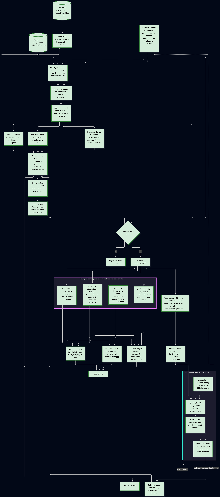

# 🎧 VibeFinder: a music recommender that starts from your MBTI type

**Applied AI System (final project).** VibeFinder extends my Module 3 *Music Recommender Simulation*. It gives a brand-new listener a starting taste profile from their 4-letter MBTI code, recommends songs they can play right in the app, checks its own results for bias, and answers questions with a Gemini assistant whose answers are verified against the songs it was given.

---

## Project Summary

### The original project

The original project was a simple music recommender that ranked songs based on a user's taste profile. It used song features like genre, mood, energy, tempo, valence, danceability, and acousticness to score each track and recommend the best matches.

It was intentionally small and easy to explain. It showed how a content-based recommender works, how changing the weights changes the results, and where the logic can become biased or overly narrow. I tested different user profiles, compared how the outputs changed, and reflected on why some songs keep appearing because of exact genre or mood matches.

### What VibeFinder adds

Real recommenders have a **cold-start problem**: a new user has no listening history, so there is nothing to learn from. VibeFinder answers that with a starting guess from the four MBTI letters, then sharpens it if the user picks songs they already like.

- **MBTI to taste profile.** Each letter nudges the numbers the original scorer already reads (energy, valence, acousticness, danceability, tempo, plus a favorite genre and mood). Users never type numbers.
- **Listening history blend.** Optional. Songs the user picks (a Receiptify snapshot of my top tracks, not live Spotify) are mixed into the profile.
- **Trust checks.** A confidence score and a bias check that warns when one genre dominates the results.
- **"Mix it up".** An optional diversity rule: at most 2 songs per genre.
- **Playback.** A 30-second preview plays inside the app for songs found on iTunes, with YouTube and Spotify links for every song.
- **Gemini assistant (RAG).** Answers questions using only the songs, profile, and MBTI text it retrieved, and every song it names is verified. If Gemini is down or names a song it was not given, the app falls back to a catalog-only answer and logs why.
- **"What is MBTI?" explainer.** Built into the app, including an honest note that the MBTI-music link is a design choice for this project, not proven science.
- **Reliability testing.** A pytest suite and an evaluation script that runs all 16 types.

---

## How The System Works

### The scoring recipe (from Module 3, unchanged)

This is a content-based music system. Instead of looking at what other users listen to, it compares each song to the user's taste profile using the song's own features.

Each song in `data/songs.csv` has: `id`, `title`, `artist`, `genre`, `mood`, `energy`, `tempo_bpm`, `valence`, `danceability`, `acousticness`. The feature values are **hand-estimated**, not pulled from an audio analysis service.

The scorer (`score_song` in `src/recommender.py`) reads these profile keys:
`favorite_genre`, `favorite_mood`, `target_energy`, `target_valence`, `preferred_acousticness`, `preferred_danceability`, `preferred_tempo`.

| Signal | How it scores | Weight |
|---|---|---|
| Genre | exact match | +2.0 |
| Mood | exact match | +1.0 |
| Energy | closeness, `1 - abs(song - target)` | up to 1.5 |
| Valence | closeness | up to 1.0 |
| Acousticness | closeness | up to 0.8 |
| Danceability | closeness | up to 0.5 |
| Tempo | closeness, difference divided by 104 (164 - 60) | up to 0.3 |

The maximum score is 7.1. After scoring every song, `recommend_songs` sorts them and returns the top K with the reasons behind each score. For example, if the user likes slow, romantic, reflective songs, a mellow indie pop track with warm valence and moderate energy should score higher than an intense rock song with a completely different mood.

### From MBTI letters to a taste profile (`src/mbti.py`)

Start from a neutral profile (energy 0.60, valence 0.65, acousticness 0.30, danceability 0.65, tempo 100 BPM), then let each letter nudge it:

| Letter | Effect |
|---|---|
| **I** | energy -0.20, danceability -0.10, acousticness +0.10, tempo -15 |
| **E** | energy +0.20, danceability +0.15, acousticness -0.10, tempo +15 |
| **S** | acousticness +0.10 |
| **N** | acousticness -0.10, valence -0.05 |
| **T** | valence -0.10 |
| **F** | valence +0.10 |
| **J** | tempo -5 |
| **P** | tempo +10, danceability +0.05 |

Values are clamped (0 to 1, tempo 60 to 164 BPM). Genre and mood come from letter pairs:

| I/E + S/N | Genre | | I/E + T/F | Mood |
|---|---|---|---|---|
| IN | indie pop | | IT | focused |
| IS | lofi | | IF | nostalgic |
| EN | pop | | ET | intense |
| ES | rock | | EF | happy |

Example: INFP becomes indie pop, nostalgic, energy 0.40, valence 0.70, acousticness 0.30, danceability 0.60, tempo 95 BPM.

The **guardrail** (`validate_mbti`) accepts exactly one letter from each pair, in the order E/I, S/N, T/F, J/P, and rejects everything else with a message that says which letter is wrong. The 16 type names and four families (Analysts, Diplomats, Sentinels, Explorers) are 16Personalities-style **display labels only**. The songs come from the four letters, never from the name or family. See [diagrams/mbti_types.mmd](diagrams/mbti_types.mmd).

### Listening history, confidence, bias check, and "Mix it up" (`src/insights.py`)

- **History blend.** Songs the user picks are averaged and mixed into the profile: 1 song counts for 20%, 2 for 40%, 3 or more for 60%. The favorite genre or mood is replaced only when at least half of the picked songs share one.
- **Confidence score.** 30% with MBTI alone, plus 15% for each picked song up to 3 (maximum 75%). It is labeled Low, Medium, or Higher. It is a rule of thumb about how much information the system has, **not a probability**.
- **Bias check.** Warns when 3 or more of the top 5 songs share a genre, or when a song that only matches the genre is ranked above one that only matches the mood. It never changes the ranking.
- **Mix it up.** Optional. Walks the full ranked list and keeps at most 2 songs per genre. Songs promoted this way are marked "added for variety", and scores are never changed.

### The Gemini assistant (`src/assistant.py`)

This is retrieval-augmented generation, and the retrieved data really shapes the answer:

1. **Guardrail.** An empty question is rejected without calling Gemini. A question over 300 characters is cut, and square brackets are removed from it.
2. **Retrieve.** The top 10 songs for this user's profile (from the same scorer), the profile in plain words, the type description, the MBTI explainer text, and any songs the user picked.
3. **Prompt.** Gemini may only recommend songs from that list and must write every title in `[square brackets]`. The question sits in a marked block so it cannot change the rules.
4. **Ask.** The model name lives in one place (`DEFAULT_MODEL`, or the `GEMINI_MODEL` environment variable). A busy model (503 or 429) is retried.
5. **Verify.** Every `[bracketed title]` must be one of the 10 retrieved songs. This checks which songs are named. It does not check that every sentence of the explanation is true.
6. **Fallback.** If Gemini errors, answers empty, or names a song it was not given, the app shows a catalog-only answer and logs the reason. The app never shows an unchecked answer and never crashes.

The API key is read from the `GEMINI_API_KEY` environment variable only. It is never written to a file, and error messages hide it.

### Playback (`src/playback.py`)

For each song the app asks the free iTunes Search API (no key needed) for a 30-second preview and plays it with `st.audio`. A preview is used only if both title and artist match the song, so the wrong song is never played. Results are cached in `data/preview_cache.json` (not committed). If nothing is found or the network fails, the song shows "No preview found" and YouTube and Spotify search links. Songs in the catalog that are not on iTunes simply have no preview.

### Logging and guardrails

| Where | What it does |
|---|---|
| `src/mbti.py` | Rejects invalid MBTI codes with a clear message |
| `src/pipeline.py` | Keeps K between 1 and 10, rejects an empty catalog, skips unknown history titles |
| `src/assistant.py` | Question limits, answer verification, fallback, key never printed |
| `src/playback.py` | Strict title and artist matching, timeouts, errors never crash the app |
| `src/applogging.py` | Logs to the console and to `logs/vibefinder.log` (not committed) |

### Biases and limits

This system is useful, but it can still be biased. It may over-prioritize popular or viral songs, ignore older songs that fit the user's mood, or become too narrow if the profile is built around one genre or one emotional state. In short, it works well for matching taste, but it is still a simplified version of how real recommenders behave. The measured limits of VibeFinder are in [Limitations and Risks](#limitations-and-risks).

---

## System Architecture

This diagram shows the whole system. Green boxes are built and covered by tests (the Gemini call is tested with a fake model, since tests must not need a network or a key). The yellow panels only group related boxes.



Source: [diagrams/architecture.mmd](diagrams/architecture.mmd)

### MBTI types and how they map to songs

All 16 types, grouped into four families. The family and type name are display labels only. Songs are matched from the four letters.


Source: [diagrams/mbti_types.mmd](diagrams/mbti_types.mmd)

---

## Getting Started

### Setup

1. Create and activate a virtual environment:

   ```bash
   python3 -m venv .venv
   source .venv/bin/activate        # Mac, Linux, Git Bash, or WSL
   .\.venv\Scripts\Activate.ps1     # Windows PowerShell
   ```

2. Install dependencies:

   ```bash
   python -m pip install --upgrade pip
   pip install -r requirements.txt
   ```

3. **Optional but recommended: add a Gemini API key.** Create a key at [Google AI Studio](https://aistudio.google.com/apikey) and make it available as an environment variable named `GEMINI_API_KEY`. In GitHub Codespaces, add it as a Codespaces secret with that exact name, then stop and start the Codespace. Elsewhere:

   ```bash
   export GEMINI_API_KEY="paste-only-the-key-here"
   ```

   Use only the key itself (one line, no labels). Never commit it. **The app works without a key:** the assistant box then shows a clearly labeled catalog-only answer.

4. Run the app:

   ```bash
   python -m streamlit run app.py
   ```

   Then open the link Streamlit prints (in Codespaces, click "Open in Browser").

### Other commands

```bash
python -m pytest -q                 # run all tests (no network or key needed)
python -m src.evaluate              # run all 16 MBTI types and print the results
python -m src.evaluate --markdown   # same, as a table for this README
python -m src.main                  # the original Module 3 profile experiment
python -m src.playback              # live check of the iTunes preview lookup (needs internet)
python -m src.assistant             # live check of Gemini (needs GEMINI_API_KEY)
python -m src.assistant --models    # list the Gemini models your key can use
```

### Using the app

1. Type your 4 MBTI letters or pick one of the 16 types.
2. Optionally turn on "Blend in songs I listen to" and pick a few songs.
3. Read the starting taste profile and open "What is MBTI, and how does it connect to music?".
4. Play the previews on the five song cards. Open "Why this song" to see the score reasons.
5. Check the confidence score and the bias check. Turn on "Mix it up" and watch the warning change.
6. Ask the assistant a question. Each answer is labeled **checked answer from Gemini** or **fallback answer**.

A photo of preview a working app  
/workspaces/applied-ai-system-project-music-recommender/assets/preview_test.png

---

## Sample Output

A real run for **INFP** (no listening history), from `run_pipeline("INFP", songs)` on the 75-song catalog:

```
Type: INFP (Mediator, Diplomats)
Profile: indie pop / nostalgic, energy 0.4, valence 0.7, acousticness 0.3, danceability 0.6, tempo 95 BPM
Confidence: 30% (Low)

1. Ribs by Lorde (indie pop, nostalgic) - 90% match
      - genre match (+2.0)
      - mood match (+1.0)
      - energy close to target (+1.35)
      - valence close to target (+0.65)
      - acousticness close to target (+0.76)
      - danceability close to target (+0.45)
      - tempo close to target (+0.20)
2. Dreams Tonite by Alvvays (indie pop, nostalgic) - 90% match
3. Space Song by Beach House (indie pop, nostalgic) - 87% match
4. Honeybee by Olivia Rodrigo (indie pop, romantic) - 80% match
5. Love You More by Two Cheers (indie pop, romantic) - 79% match

Bias check: 5 of your top 5 songs are indie pop. Your results lean heavily on one genre.
```

The same INFP with **Mix it up** on keeps the two best indie pop songs and then adds Affection (lofi, 63%), 18 (pop, 62%), and Expectations (folk, 62%), each marked "added for variety". The bias warning goes away, and the cost is lower match scores.

---

## Evaluation (reliability testing)

`python -m src.evaluate` runs all 16 types through the real pipeline with no network and no API key. Results on the 75-song catalog (top 5, no history):

| Check | Result |
|---|---|
| Top song matches both genre and mood | 16 / 16 |
| Every type returns 5 songs, sorted by score | yes |
| Same input gives the same output twice | yes |
| "Mix it up" keeps every genre at 2 or fewer songs | 16 / 16 |
| Confidence with 3 history songs | 75% (30% without) |
| Top song changes when 3 history songs are added | 16 / 16 types |
| Average distinct genres in the top 5 (default) | 1.0 |
| Types where the bias check warns | 16 / 16 |
| Different top songs across the 16 types | 9 / 16 |
| Pairs of types with the same top 5 songs (order may differ) | 15 |
| Average match, plain vs "Mix it up" | 84.2% vs 74.7% |

The per-type table is printed by `python -m src.evaluate --markdown`.

**Tests** (`python -m pytest -q`, no network or key needed):

| File | Covers |
|---|---|
| `tests/test_mbti.py` | validation, all 16 profiles, type table, explainer |
| `tests/test_insights.py` | history blend, confidence, bias check, diversity rule |
| `tests/test_pipeline.py` | the full flow, guardrails, logging |
| `tests/test_assistant.py` | question limits, answer verification, fallback, retries and key safety with a fake Gemini |
| `tests/test_playback.py` | preview matching, cache, and errors with a fake web call |
| `tests/test_uihelpers.py` | the helpers behind the screen |
| `tests/test_evaluate.py` | the evaluation script itself |
| `tests/test_recommender.py` | the original starter tests |

---

## Experiments You Tried

These experiments are from **Module 3, on the original 20-song catalog** (before the catalog grew to 75 songs), so the songs and scores differ from the sample output above.

I tested four user profiles and looked at the top 5 results for each.

### High-Energy Pop

```
=== High-Energy Pop ===
1. Sunrise City by Neon Echo
   Score: 6.83
   Why:
      - genre match (+2.0)
      - mood match (+1.0)
      - energy close to target (+1.38)
      - valence close to target (+0.96)
      - acousticness close to target (+0.74)
      - danceability close to target (+0.47)
      - tempo close to target (+0.28)

2. Gym Hero by Max Pulse
   Score: 5.95
   Why:
      - genre match (+2.0)
      - energy close to target (+1.46)
      - valence close to target (+0.97)
      - acousticness close to target (+0.76)
      - danceability close to target (+0.48)
      - tempo close to target (+0.28)

3. Rooftop Lights by Indigo Parade
   Score: 4.66
   Why:
      - mood match (+1.0)
      - energy close to target (+1.29)
      - valence close to target (+0.99)
      - acousticness close to target (+0.60)
      - danceability close to target (+0.48)
      - tempo close to target (+0.30)

4. Magoots for Brain by Olivia Rodrigo
   Score: 3.84
   Why:
      - energy close to target (+1.48)
      - valence close to target (+0.87)
      - acousticness close to target (+0.78)
      - danceability close to target (+0.48)
      - tempo close to target (+0.22)

5. Storm Runner by Voltline
   Score: 3.59
   Why:
      - energy close to target (+1.48)
      - valence close to target (+0.68)
      - acousticness close to target (+0.80)
      - danceability close to target (+0.41)
      - tempo close to target (+0.22)
```

Observation: Sunrise City and Gym Hero lead, which matches what I expected. Positions 4 and 5 have no genre or mood match and rank only because their energy is close to 0.9.

### Chill Lofi

```
=== Chill Lofi ===
1. Library Rain by Paper Lanterns
   Score: 7.03
   Why:
      - genre match (+2.0)
      - mood match (+1.0)
      - energy close to target (+1.50)
      - valence close to target (+1.00)
      - acousticness close to target (+0.75)
      - danceability close to target (+0.49)
      - tempo close to target (+0.29)

2. Midnight Coding by LoRoom
   Score: 6.86
   Why:
      - genre match (+2.0)
      - mood match (+1.0)
      - energy close to target (+1.40)
      - valence close to target (+0.96)
      - acousticness close to target (+0.73)
      - danceability close to target (+0.49)
      - tempo close to target (+0.29)

3. Focus Flow by LoRoom
   Score: 5.98
   Why:
      - genre match (+2.0)
      - energy close to target (+1.42)
      - valence close to target (+0.99)
      - acousticness close to target (+0.78)
      - danceability close to target (+0.50)
      - tempo close to target (+0.29)

4. Spacewalk Thoughts by Orbit Bloom
   Score: 4.71
   Why:
      - mood match (+1.0)
      - energy close to target (+1.40)
      - valence close to target (+0.95)
      - acousticness close to target (+0.70)
      - danceability close to target (+0.41)
      - tempo close to target (+0.26)

5. Coffee Shop Stories by Slow Stereo
   Score: 3.81
   Why:
      - energy close to target (+1.47)
      - valence close to target (+0.89)
      - acousticness close to target (+0.73)
      - danceability close to target (+0.47)
      - tempo close to target (+0.26)
```

Observation: The three lofi songs take the top three, and Library Rain edges out Midnight Coding on closeness alone.

### Deep Intense Rock

```
=== Deep Intense Rock ===
1. Storm Runner by Voltline
   Score: 7.04
   Why:
      - genre match (+2.0)
      - mood match (+1.0)
      - energy close to target (+1.48)
      - valence close to target (+0.97)
      - acousticness close to target (+0.80)
      - danceability close to target (+0.49)
      - tempo close to target (+0.29)

2. Heaven by Bryan Adams
   Score: 5.12
   Why:
      - genre match (+2.0)
      - energy close to target (+1.20)
      - valence close to target (+0.67)
      - acousticness close to target (+0.63)
      - danceability close to target (+0.46)
      - tempo close to target (+0.17)

3. Gym Hero by Max Pulse
   Score: 4.56
   Why:
      - mood match (+1.0)
      - energy close to target (+1.48)
      - valence close to target (+0.68)
      - acousticness close to target (+0.76)
      - danceability close to target (+0.39)
      - tempo close to target (+0.25)

4. Burning Down the House by Talking Heads
   Score: 3.89
   Why:
      - energy close to target (+1.47)
      - valence close to target (+0.98)
      - acousticness close to target (+0.78)
      - danceability close to target (+0.40)
      - tempo close to target (+0.26)

5. Magoots for Brain by Olivia Rodrigo
   Score: 3.74
   Why:
      - energy close to target (+1.46)
      - valence close to target (+0.78)
      - acousticness close to target (+0.78)
      - danceability close to target (+0.42)
      - tempo close to target (+0.29)
```

Observation: Storm Runner wins by a wide margin. Heaven ranks second just for being rock, even though its mood is romantic.

### Indie Pop Romantic

```
=== Indie Pop Romantic ===
1. Stupid Song by Olivia Rodrigo
   Score: 5.65
   Why:
      - genre match (+2.0)
      - energy close to target (+1.47)
      - valence close to target (+0.65)
      - acousticness close to target (+0.78)
      - danceability close to target (+0.46)
      - tempo close to target (+0.29)

2. Rooftop Lights by Indigo Parade
   Score: 5.37
   Why:
      - genre match (+2.0)
      - energy close to target (+1.26)
      - valence close to target (+0.89)
      - acousticness close to target (+0.60)
      - danceability close to target (+0.39)
      - tempo close to target (+0.23)

3. Heaven by Bryan Adams
   Score: 4.58
   Why:
      - mood match (+1.0)
      - energy close to target (+1.32)
      - valence close to target (+0.92)
      - acousticness close to target (+0.57)
      - danceability close to target (+0.48)
      - tempo close to target (+0.29)

4. My Friend by Mark Lee
   Score: 3.95
   Why:
      - energy close to target (+1.46)
      - valence close to target (+0.96)
      - acousticness close to target (+0.78)
      - danceability close to target (+0.47)
      - tempo close to target (+0.28)

5. Meet Me Where I Am At by Evangeline
   Score: 3.74
   Why:
      - energy close to target (+1.46)
      - valence close to target (+0.82)
      - acousticness close to target (+0.69)
      - danceability close to target (+0.49)
      - tempo close to target (+0.28)
```

Observation: Stupid Song (melancholic) beats Heaven, the only romantic song, because the genre bonus is worth twice the mood bonus.

### Experiment 1: Genre weight (2.0 down to 0.0)

For Indie Pop Romantic, lowering genre to 0.5 put Heaven, the only romantic
song, at #1. For the other three profiles the top song never changed, so
genre mostly decides the order of positions 2 to 3.

### Experiment 2: Valence and tempo weighted more heavily

The top 3 stayed in the same order for all four profiles. Scores went up,
but the rankings did not change, so these features act as tie-breakers.

### Experiment 3: Weight shift (genre halved, energy doubled)

| Profile | Change in top 5 |
|---|---|
| High-Energy Pop | None (order unchanged) |
| Chill Lofi | None (order unchanged) |
| Deep Intense Rock | Heaven dropped from #2 to #4 |
| Indie Pop Romantic | Heaven rose from #3 to #2; Stupid Song still #1 |

Overall this made the results different, not clearly more accurate. It helped Rock, where Heaven's romantic mood didn't fit "intense," but it didn't fix Indie Pop Romantic. Lowering the genre weight alone worked better for that profile. The scores are on a different scale after the change (max 7.6 instead of 7.1), so only rankings can be compared.

### Bug I found while testing

My first run only scored genre and mood. Every score was a whole number and no energy line appeared, because `score_song` was reading different key names than my profiles used (e.g. `energy` vs. `target_energy`). I fixed the keys and reran, and the results above are from the fixed version.

### Does it match my intuition?

For straightforward profiles, mostly yes. High-Energy Pop put Sunrise City and Gym Hero on top, which feels right for bright, punchy songs. Chill Lofi felt even more natural: Library Rain, Midnight Coding, and Focus Flow are what I'd actually play while studying. The weak spot was Rooftop Lights at #3 for High-Energy Pop. It's there because of its "happy" mood, which feels more like a scoring artifact than a real recommendation.

Indie Pop Romantic felt the most off. Stupid Song (melancholic) ranked #1 above Heaven, the only romantic song, because the genre bonus (+2.0) is twice the mood bonus (+1.0). The system is explainable and consistent, but it treats genre as a shortcut and misses the emotional vibe.

---

## Limitations and Risks

These come from the evaluation above and from building the extension.

- **Genre dominates everything.** A genre match is worth double a mood match, so with the default settings **every one of the 16 types gets a top 5 from a single genre** (average 1.0 distinct genres, and the bias check warns for all 16). "Mix it up" fixes this, at the cost of a lower average match (84.2% to 74.7%).
- **The letters change the order more than the songs.** Only 9 different top songs appear across the 16 types, and 15 pairs of types receive the same five songs in a different order. Types that share a genre and differ in one letter, such as INTJ and INTP, differ only a little in tempo and danceability.
- **MBTI is a weak signal.** The mapping from letters to music is a design choice I made for this project, not a proven rule, and MBTI itself is debated by psychologists. It also risks stereotyping: every "I" gets calmer music, every "E" gets louder music. That is why the app shows a confidence score, an honest explainer, and a note to try neighboring letters.
- **The catalog skews toward one person's taste.** 45 of the 75 songs come from my own Receiptify top tracks, plus 20 starter songs and 10 songs added to fill genre and mood gaps. Some of the starter songs are fictional. Genre and mood labels are my judgment, and the numeric features are hand-estimated.
- **The listening history is a snapshot, not live Spotify.** It is one person's top tracks from one month. Confidence is capped at 75% because three songs are not a full listening history.
- **Verification checks titles, not truth.** The assistant's answer is checked to name only songs it was given. It does not verify every claim in the explanation text.
- **Gemini can be slow or unavailable.** The app retries a busy model, then falls back to a catalog-only answer. Model names also get retired, so `DEFAULT_MODEL` may need updating.
- **Previews depend on iTunes.** Songs that are not on iTunes have no preview and show YouTube and Spotify search links instead.

---

## Responsible AI Notes

- **Privacy.** The listening history contains only song titles and artists from a public chart snapshot. The Receiptify image itself, which shows an account name, is **not** in this repo. No API keys or logs are committed (`.env`, `logs/`, and `data/preview_cache.json` are in `.gitignore`).
- **Honesty about confidence.** The confidence score is a rule of thumb and is labeled that way. The assistant is told to say that MBTI is a rough guess.
- **Human in the loop.** The user can edit a letter, pick different songs, or turn "Mix it up" on and see how the results change. Nothing is hidden behind a single score.
- **Credits.** Song previews come from Apple's iTunes Search API. MBTI type names and families follow 16Personalities-style labels and are not official MBTI terms.
- **AI collaboration.** I built this extension with help from an AI assistant (Claude), and I used Gemini inside the app. I ran the tests, the evaluation, and the app myself. One example where the AI was wrong: it suggested a Gemini backup model that Google had already closed to new users, and it only showed up when I ran the live check.

---

## Reflection

Read and complete `model_card.md`:

[**Model Card**](model_card.md)

My biggest learning moment was realizing that a recommender does not need a fancy model to feel personal. A simple score can still feel convincing because it gives a lot of weight to a few obvious signals like genre and mood. That was the big idea for me: a recommender is basically a system that turns a bunch of song features and user preferences into a ranking. It is not magic — it is just a way of deciding what counts as a good match.

I also learned that bias can sneak in really easily. In this project, exact genre and mood matches were so powerful that they could overshadow other important signals like energy, valence, and tempo. That means a user can get stuck in a narrow filter bubble, even when the system looks useful. It was also surprising to me that a very simple algorithm can still "feel" like recommendations, because the output looks thoughtful even when it is mostly rule-based. For example, a song like "Gym Hero" keeps showing up for happy pop users because it matches the labels well, not because the system is somehow truly understanding the user's taste.

Using AI tools helped a lot because they helped me test ideas quickly and debug the scoring logic. I could try different weights and see the output immediately, which made it much easier to understand what was happening. But I still had to double-check the math and the actual code, because the AI could suggest a version that looked reasonable even when it did not fully match the project rules or the dataset. I had to check whether the model was really using the right fields, and whether the ranking made sense for real listeners.

**What the final project taught me.** The evaluation showed that the MBTI letters change the order of the songs more than which songs appear. Every type got a single-genre list, and 15 pairs of types received the same five songs, so the genre bonus was still doing most of the work. That is the same bias I found in Module 3, now measured across 16 types, and it is why I added the bias check and the "Mix it up" option instead of hiding the problem. The other lesson was about reliability: Gemini was busy or unavailable at times, so the app has to be useful and honest when the AI part fails, not only when it works.

If I extended this project further, I would try a more balanced scoring system so genre does not dominate everything, make "Mix it up" the default, and let people tell the system which of their songs they like instead of relying on letters. I would also test more realistic user profiles, like "happy but low energy" or "romantic but upbeat".

---

## Project Structure

```
app.py                  Streamlit app (run this)
src/
  recommender.py        Module 3 scorer: load_songs, score_song, recommend_songs
  mbti.py               validation guardrail, letters to profile, 16 types, explainer
  insights.py           history blend, confidence, bias check, "Mix it up"
  pipeline.py           runs the whole flow (orchestration)
  assistant.py          Gemini RAG assistant with verification and fallback
  playback.py           iTunes previews, cache, YouTube and Spotify links
  uihelpers.py          small helpers for the screen
  applogging.py         logging setup
  evaluate.py           runs all 16 types and prints the results
  main.py               original Module 3 profile experiment
data/songs.csv          75 songs
diagrams/               architecture.mmd and mbti_types.mmd (Mermaid sources)
assets/                 architecture.png and mbti_types.png
tests/                  pytest suite
.streamlit/config.toml  light theme
model_card.md           model card
```